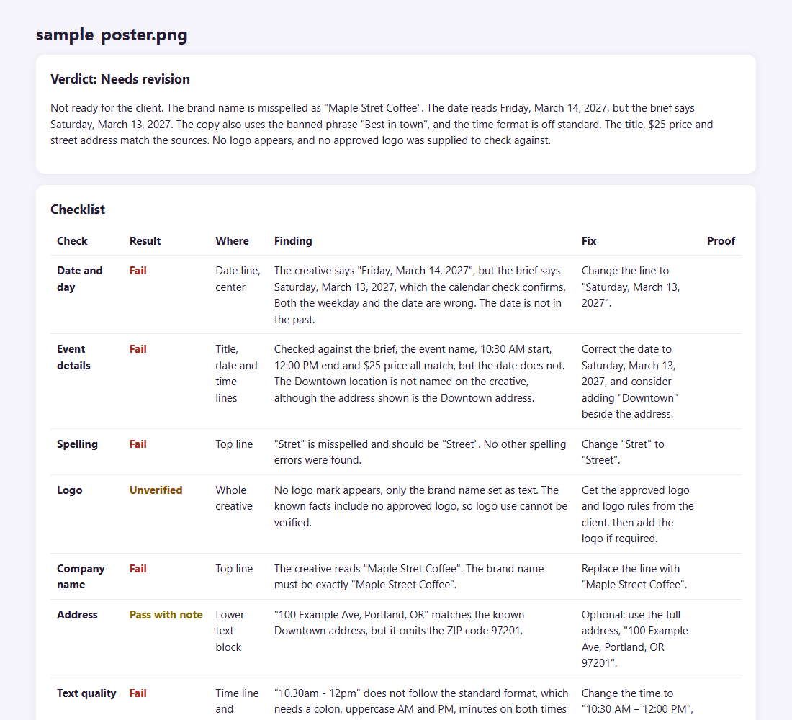

# creative-qa-checker

An AI proofreader for marketing creative. It reads the actual frames and audio, checks them against the brief and your brand facts, and shows what to fix.



*Real run on the deliberately flawed sample poster*

## Why it exists

Wrong dates and misspelled brand names slip through because the same person who made the file checks it. This adds a second reader that doesn't get tired.

## How it works

- Extracts frames, audio transcript, scene cuts and loudness with ffmpeg and Whisper
- Checks weekdays against a real calendar
- Claude reviews every frame against the brief and `facts.json`
- Marks a check Unverified when there is no source of truth, and never guesses a pass
- Scores likely Instagram performance by area

## Run it

```bash
pip install -r requirements.txt
# ffmpeg must be on PATH. Set ANTHROPIC_API_KEY or have Claude Code installed.
python app.py    # http://127.0.0.1:8040
# Try sample/sample_poster.png with the brief:
# Latte Art Workshop. Saturday March 13 2027, 10:30 AM to 12:00 PM, $25.
```

## Notes

The sample brand, Maple Street Coffee, is fictional. Set your own brand in `facts.json`.

## Stack

Python, FastAPI, ffmpeg, Whisper, Claude vision

Built by [Vinay Kumar](https://vinaykumar.work) with Claude Code. I set the design and rules and reviewed the output.
